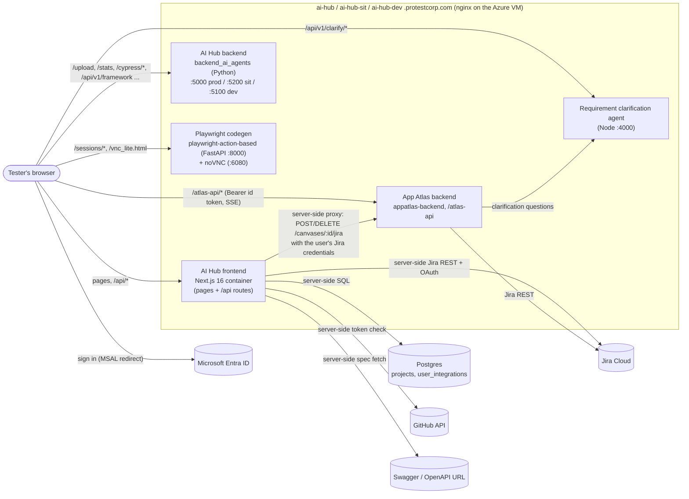

# AI Hub frontend (`aihub_frontend_projects`)

The web app of **AI Hub**, Pro-Test's suite of AI testing accelerators. Testers sign in with Microsoft, pick a project,
and run accelerators that generate test cases and test data, generate and self-heal automation scripts, record user
journeys in a remote browser, and ask clarifying questions about requirements. It also hosts the **App Atlas**
workspace: record a journey through an app, turn it into a canvas of screens, and map each screen to Jira tickets.

It is a Next.js 16 (App Router) app. Almost everything runs in the browser; a few Next.js API routes run on the server
for the things the browser must not hold (Jira / GitHub credentials, the Postgres connection).

| Environment | URL | Container (host port) | Built from |
|---|---|---|---|
| Prod | https://ai-hub.protestcorp.com | `frontend` (3000) | `main` / last promote from sit (may lag dig) |
| SIT | https://ai-hub-sit.protestcorp.com | `frontend-sit` (3200) | promote from dig, or `dev` |
| Dig (dev) | https://ai-hub-dev.protestcorp.com | `frontend-dev` (3100) | `dev` |

**Frontends are per env. App Atlas API is one shared container** for dig/sit/prod (`/atlas-api/` → `appatlas-backend`).
Ops/logs UI is **not** in this repo: https://logs.protestcorp.com/admin/ (see appatlas-backend architecture docs).

**More documentation**

| Doc | What's in it |
|---|---|
| [docs/ONBOARDING.md](docs/ONBOARDING.md) | **Start here** if you are new to this frontend |
| [docs/ARCHITECTURE.md](docs/ARCHITECTURE.md) | Route map, state and data flow, Microsoft sign-in, App Atlas workspace, design choices |
| [docs/ENDPOINTS.md](docs/ENDPOINTS.md) | Every backend endpoint the app calls (by service), plus the app's own pages and API routes |
| [docs/CONFIGURATION.md](docs/CONFIGURATION.md) | Every environment variable, what it does, and which environment needs it |
| `API.md`, `FRONTEND.md`, `docs/architecture/` in [appatlas-backend](https://github.com/Pro-Test-Consulting-Private-Limited/appatlas-backend) | Atlas API contract + ops dashboard (Phase 4 watchdog) |

---

## Features

| Area | Route | What it does | Backend |
|---|---|---|---|
| Sign in | `/` | "Sign in with Microsoft" (Entra ID, redirect flow). Email/password and sign-up are placeholders ("coming soon"). | Microsoft Entra ID |
| Home dashboard | `/home` | Project list (AI Hub and App Atlas tabs), backend health, AI model status, usage stats, model cost for the month | AI Hub backend, clarification agent |
| Projects | `/projects`, `/projects/<id>` | Create, edit and delete projects (stored in Postgres). A project's page shows the test life-cycle wheel with its accelerators. | This app's `/api/projects` |
| Requirement Clarification Agent | `/projects/clarification-agent` | Upload a requirement document or screenshot and get clarifying questions with confidence scores | Clarification agent |
| Test case + test data generation | `/projects/generate-draft` | Upload a story PDF and get test cases and test data in a table, or download them as Excel | AI Hub backend |
| Automated script generation (Selenium) | `/projects/automated-test-script-generation` | Upload a manual test file plus the app URL and get generated code | AI Hub backend |
| Automated script generation (Cypress) | `/projects/automated-test-script-generation/cypress` | Upload an Excel of test cases plus a base URL, then browse and download the generated Cypress framework | AI Hub backend |
| Debugger | `/projects/debugger` | Upload a screenshot and get a markdown analysis | AI Hub backend |
| Action-driven test case generation | `/projects/action-driven-test-case-generator-new-run`, `/projects/action-driven-test-case-generator-rerun` | Record a journey in a remote browser (noVNC), save it, generate manual test cases; list and re-run past executions | Playwright codegen service |
| Self Healing | `/projects/self-healing` | Run a Cypress spec with a streamed log; when a selector breaks, ask the AI to heal it | AI Hub backend |
| App Atlas | `/app-atlas?projectId=<id>` | Record a journey, canvas map, Connect apps (Jira/Swagger/Teams/…), explorer Connected row, tabs for SIT / API Testing / Coverage / Security / Performance / Reports / CI/CD (flags apply), shared profile menu | Shared App Atlas backend + this app's Jira proxy; see [docs/ONBOARDING.md](docs/ONBOARDING.md) |
| Integrations | `/integrations` | Connect Jira (site, email, API token), GitHub (personal access token) or a Swagger/OpenAPI spec | This app's `/api/auth/*` and `/api/integrations` |
| Metrics | `/metrics/business-usage`, `/metrics/performance-reliability`, `/metrics/model-quality-operational` | Charts of invocations, tokens, latency, error rate, validity, healing | AI Hub backend |
| Error log | `/workplace/error-log` | Paged list of backend errors | AI Hub backend |
| Placeholders | `/domain`, `/resources`, `/settings`, `/customer-support`, `/updates`, `/billing-management/*`, `/workplace/workplace-setup`, `/workplace/user-management`, `/metrics` | "Coming soon" pages | none |

Every signed-in page also sends a silent **presence heartbeat** every 15 seconds so the operations (logs) dashboard can
show who is online on which site (`app/lib/site-presence.tsx`).

---

## Architecture overview



- **The browser talks to the backends directly.** On the three AI Hub hostnames the API base is the page's own origin
  (`siteOrigin()` in `app/config/urls.ts`), and that site's nginx routes each path to that environment's container. So
  the dev site calls dev backends and SIT calls SIT backends.
- **The Next.js server only does what needs secrets**: Postgres (`DATABASE_URL`), Jira/GitHub/Swagger credentials kept
  in httpOnly cookies, and the Jira proxy to App Atlas. See [docs/ARCHITECTURE.md](docs/ARCHITECTURE.md).

---

## Tech stack

Versions are from `package.json` (`^` ranges resolve to the newest compatible version recorded in `package-lock.json`).

| Concern | Package | Version |
|---|---|---|
| Framework | `next` | 16.3.4 (App Router; the production build uses `--webpack`) |
| UI | `react`, `react-dom` | 19.3.0 |
| Language | `typescript` | ^5 |
| Auth (Microsoft Entra ID) | `@azure/msal-browser`, `@azure/msal-react` | ^5.5.0, ^5.0.7 |
| Server-side token verification | `jose` | ^6.2.12 |
| Database (server routes) | `pg` | ^8.23.0 |
| HTTP | `axios` for the AI Hub backend (through `xhr.ts`), `fetch` for everything else | ^1.7.9 |
| Canvas (App Atlas) | `@xyflow/react` | ^12.12.0 |
| Charts | `chart.js`, `react-chartjs-2` | ^4.5.1, ^5.3.1 |
| Styling | `tailwindcss`, `sass`, `postcss` | ^3.4.1, ^1.83.4, ^8 |
| Animation | `framer-motion`, `motion` | ^12.23.22, ^13.1.0 |
| Icons | `react-icons`, `lucide-react` | ^5.7.0, 1.32.0 |
| Markdown and code view | `react-markdown`, `react-syntax-highlighter` | ^10.1.0, ^16.1.0 |
| Toasts | `react-toastify` | ^11.0.5 |
| Other | `dayjs`, `moment`, `react-csv`, `swr`, `clsx`, `tailwind-merge`, `class-variance-authority`, `next-themes`, `react-avatar` | see `package.json` |
| Lint | `eslint`, `eslint-config-next` | 10.10.0, 16.3.4 |

**Node.js:** Next.js 16 needs Node **20.9 or newer**. The Docker image uses **Node 24** (`node:24-slim`); use the same
locally.

---

## Folder structure

```
aihub_frontend_projects/
├── app/                          Next.js App Router root
│   ├── layout.tsx                Root layout: fonts, global CSS, <AuthProvider> (MSAL) and toasts
│   ├── page.tsx                  "/" = sign-in page (renders app/auth/page.tsx)
│   ├── auth/                     Sign-in and sign-up UI (sign-up is a placeholder)
│   ├── pages/                    All signed-in screens (served at pretty URLs, see "Routing" below)
│   │   ├── layout.tsx            Side nav + top nav shell, <ProjectsProvider>
│   │   ├── page.tsx              Home dashboard (/home)
│   │   ├── app-atlas/            App Atlas workspace (/app-atlas)
│   │   ├── projects/             Project list, project wheel ([...slug]) and one folder per accelerator
│   │   ├── metrics/              Metrics dashboards
│   │   ├── workplace/            Error log, plus placeholder setup and user pages
│   │   ├── integrations/         Jira / GitHub / Swagger connections
│   │   └── ...                   Placeholder pages (billing, settings, domain, resources, support, updates)
│   ├── api/                      Next.js route handlers (server-side), see docs/ENDPOINTS.md
│   │   ├── projects/             CRUD on the Postgres `projects` table
│   │   ├── integrations/         Per-user integration records (Postgres `user_integrations`)
│   │   ├── auth/{jira,github,swagger}/  Connect, disconnect, status (+ OAuth authorize/callback for Jira and GitHub)
│   │   └── app-atlas/            Jira project list and the canvas-to-Jira proxy to the App Atlas backend
│   ├── components/               Shared UI (nav, modals, dropdowns, file viewer, ...)
│   │   └── app-atlas/            App Atlas workspace, recording view, canvas, Jira panel, modals
│   ├── config/                   urls.ts (API base URLs), fonts
│   ├── constants/                Nav items, accelerator wheel, dropdown options, model states
│   ├── context/                  Metrics time-filter context
│   ├── hooks/                    useIntegrationStatus, useModelStatus
│   ├── interfaces/               TypeScript types (appatlas.ts mirrors the App Atlas API contract)
│   ├── lib/                      MSAL setup, auth guard, token helpers, Postgres pool, projects store, presence
│   ├── services/                 API clients: generate.ts, analytics.ts, workplace.ts (AI Hub), appatlas.ts
│   └── utils/, charts/, data/    Helpers, chart wrappers, static demo data
├── lib/                          Server-only helpers: Jira, GitHub, Swagger, OAuth cookies, Jira credential resolver
├── public/                       Icons and images
├── xhr.ts                        axios wrapper used by app/services/{generate,analytics,workplace}.ts
├── next.config.js                Redirects and rewrites that give app/pages/* its pretty URLs
├── Dockerfile                    Image used on the VM (build, then `npm start` on port 3000)
├── buildspec.yml                 Legacy AWS CodeBuild -> ECR -> ECS pipeline (not used by the Azure VM deploy)
├── .env.example                  Template for local settings (names only)
└── AGENTS.md / CLAUDE.md         Notes for coding agents (Next.js 16 differs from older versions)
```

The `@/` import alias points at the repo root (`tsconfig.json`), so `@/app/...`, `@/lib/...` and `@/xhr` all work.

### Routing

Screens live under `app/pages/`, but users never see `/pages` in the URL. `next.config.js`:

- **rewrites** pretty URLs to the real folders: `/home` → `/pages`, `/projects/*` → `/pages/projects/*`,
  `/app-atlas` → `/pages/app-atlas`, and likewise `/metrics/*`, `/workplace/*`, `/integrations`, `/domain`,
  `/resources`, `/billing-management/*`, `/settings`, `/customer-support`, `/updates`;
- **redirects** `/pages` → `/home`, `/pages/*` → `/*`, and `/auth` → `/`.

When you add a new top-level screen under `app/pages/`, add a rewrite for it too.

---

## Local setup

1. Install **Node 24** (minimum 20.9) and npm.
2. Install dependencies the way the Docker build does:
   ```bash
   npm install --legacy-peer-deps
   ```
3. Create `.env.local` from the template and fill in the values (ask the team; never commit them):
   ```bash
   cp .env.example .env.local
   ```
   To sign in and use the app you need the three `NEXT_PUBLIC_MICROSOFT_ENTRA_*` values and the backend base URLs.
   `DATABASE_URL` is needed for Projects and Integrations. Every variable is described in
   [docs/CONFIGURATION.md](docs/CONFIGURATION.md).
4. Make sure `http://localhost:3000/` is a registered **SPA redirect URI** on the Entra app registration.
5. Start the dev server:
   ```bash
   npm run dev
   ```
   Open http://localhost:3000 and choose **Sign in with Microsoft**.

On `localhost` the API base URLs come from the `NEXT_PUBLIC_*` variables (on the real sites they come from the page's
origin). The App Atlas backend allows `http://localhost:3000` as a CORS origin, so pointing `NEXT_PUBLIC_APPATLAS_API`
at the shared App Atlas API works for local development.

`next dev` re-adds the Next.js block in `AGENTS.md`. Commit it rather than deleting it.

### Scripts

| Script | Command | Notes |
|---|---|---|
| `npm run dev` | `next dev` | Dev server on port 3000 |
| `npm run build` | `next build --webpack` | Production build with webpack (Next 16 defaults to Turbopack; this repo opts out). `NEXT_PUBLIC_*` values are compiled in at this step. |
| `npm start` | `next start` | Serves the build on port 3000 (what the container runs) |
| `npm run lint` | `next lint` | **Broken on Next 16:** `next lint` was removed. Run `npx eslint .` instead (config in `eslint.config.mjs`). |

---

## Authentication

Sign-in is **Microsoft Entra ID** through MSAL (`app/lib/msal.ts`, `app/lib/provider.tsx`):

1. `/` shows the sign-in page. "Sign in with Microsoft" calls `loginRedirect` with the `User.Read` scope.
2. Entra redirects back to the **origin the user came from** (`window.location.origin + "/"`), so the same code works on
   prod, SIT, dev and localhost. Each origin must be registered as an SPA redirect URI.
3. `AuthProvider` initialises MSAL, handles the redirect response, and only then renders the app. Tokens are cached in
   **sessionStorage**, so a sign-in lasts as long as the browser tab.
4. Signed-in pages are wrapped in `AuthGuard` (`app/lib/authguard.tsx`), which sends signed-out users back to `/`.
5. Calls that need the user's identity send the **Entra ID token** as `Authorization: Bearer <id token>`: App Atlas,
   this app's `/api/projects` (writes), `/api/integrations` and `/api/app-atlas/*`, and the presence heartbeat.
   `getFreshIdToken` (`app/lib/auth-client.ts`) refreshes the token when it expires within 2 minutes and falls back to
   a redirect sign-in if silent renewal fails.
6. Server routes verify that token with `jose` against the tenant's published keys (issuer, and audience = the client
   ID) in `app/lib/auth-server.ts`.

Details and a sequence diagram are in [docs/ARCHITECTURE.md](docs/ARCHITECTURE.md#authentication-msal-flow).

---

## Build and deployment

All three environments run on one Azure VM as Docker containers behind nginx. They are built **on the VM** by the
`aihub-deploy` script, which lives in the appatlas-backend repo (`deploy/aihub-deploy.sh`).

```bash
aihub-deploy frontend <prod|sit|dev> [branch-or-commit]   # build and (re)start one environment
aihub-deploy promote frontend dev sit                     # put exactly the commit running on dev onto SIT
aihub-deploy promote frontend sit prod                    # ...and the commit running on SIT onto prod
aihub-deploy rollback frontend <env>                      # back to the image before the last deploy
aihub-deploy status                                       # which commit runs where
```

What `aihub-deploy frontend <env>` does:

1. Clones or fetches this repo into a build folder on the VM and checks out the branch or commit. Default branches:
   prod = `main`; SIT = `sit` if that branch exists, otherwise `dev`; dev = `dev`.
2. Copies that environment's **`.env.production`** (kept on the VM, outside git) into the build folder, replacing any
   copy in the repo. Because `NEXT_PUBLIC_*` values are compiled into the JavaScript at build time, **each environment
   gets its own build**, even from the same commit.
3. Runs `docker build` with the repo's `Dockerfile` (Node 24: `npm install --legacy-peer-deps`, `npm run build`, then
   `npm start`), labels the image with the commit, and keeps the previous image as `<image>:<env>-previous`.
4. Recreates the container (`frontend` on host port 3000, `frontend-sit` on 3200, `frontend-dev` on 3100; all listen on
   3000 inside) with a per-container runtime env file, then checks that the site answers.

`promote` rebuilds the same commit with the target environment's settings, so promotion never changes the code.

`buildspec.yml` is an older AWS CodeBuild → ECR → ECS pipeline and isn't used by the Azure deployment.

### Branch strategy

| Branch | Deployed to | Notes |
|---|---|---|
| `dev` | Dev and SIT | Integration branch. Merge feature branches here, deploy dev, then promote dev → SIT. |
| `main` | Prod | Prefer `aihub-deploy promote frontend sit prod` so prod matches tested dig/sit commits. |
| `sit` | Optional | If present, `aihub-deploy frontend sit` may prefer it; otherwise dig/sit use `dev`. |

Prefer `promote` (dig → sit → prod) over building prod from a random branch, so prod gets exactly what was tested.

---

## Troubleshooting

| Symptom | Likely cause and fix |
|---|---|
| Sign-in loops back to `/`, or Entra reports a redirect URI mismatch | The site's origin (with a trailing `/`) isn't a registered SPA redirect URI on the Entra app, or the client/tenant ID in the build is wrong. |
| Blank page after sign-in; the console shows "MSAL initialization error" | A broken MSAL cache. The app clears `msal*` keys from sessionStorage automatically; reload, or close the tab and sign in again. |
| Pages keep bouncing to Microsoft sign-in | Silent token renewal fails (often because third-party cookies are blocked), so `getFreshIdToken` falls back to a redirect. Allow cookies for `login.microsoftonline.com`. |
| App Atlas, Projects or Integrations return 401 | The ID token expired, or the server's `NEXT_PUBLIC_MICROSOFT_ENTRA_TENANT_ID` / `NEXT_PUBLIC_MICROSOFT_ENTRA_CLIENT_ID` don't match the token. The App Atlas client retries once with a forced refresh. |
| Projects page: "Failed to load projects (500)" | `DATABASE_URL` is missing or wrong in the container, or the `projects` table doesn't exist. The Postgres server doesn't accept SSL, so don't add `sslmode`. |
| "Jira is not connected. Connect it in Integrations." (409) | Jira credentials are stored in **cookies for this site**. Connect Jira on `/integrations` on the same site; prod, SIT, dev and localhost cookies are separate. |
| "Your Jira session expired" (401) in App Atlas | The Jira OAuth refresh token was rejected. Disconnect and reconnect Jira on `/integrations`. |
| App Atlas live browser stuck on the neko logo | The network blocks neko's WebRTC port. Click "Switch to the compatible viewer" (noVNC); the choice is remembered in localStorage. |
| The remote browser tab for action-driven runs is blank or doesn't open | The Playwright codegen container for that environment is down, or the browser blocked the popup. Allow popups for the site. |
| Home shows the AI model as "Inactive" or "Initializing" | The clarification agent reports that the Hugging Face endpoint is stopped or starting. The badge polls every 10–30 seconds. |
| Dev or SIT shows data from another environment | Check that site's nginx routes; on `ai-hub*.protestcorp.com` the frontend always calls its own origin. |
| A new screen under `app/pages/foo` 404s at `/foo` | Add a rewrite for it in `next.config.js`. |
| `npm run lint` fails | `next lint` doesn't exist in Next 16. Use `npx eslint .`. |
| `npm install` fails on peer dependencies | Use `npm install --legacy-peer-deps`, as the Dockerfile does. |
| The container won't start after a deploy | On the VM: `docker logs --tail 100 frontend-dev` (or `frontend-sit`, `frontend`), then `aihub-deploy rollback frontend <env>`. |
